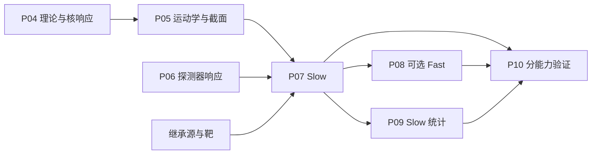

# CsI2021 三文件输入包 P04–P10 最终执行报告

本次完成了既有 CsI2021 输入包的实际执行审计与交付准备。固定版本的完整理论/核响应、截面、
探测器、Slow 数值检查、22 算符 Fast 工程候选和旧近似统计分别给出证据。
科学交付仍为 PARTIAL；正式 Fast、外部核响应/反中微子审计、官方统计及最终科学声明没有获批。
当前工作树同期迁移引入的兼容失败保留，不能把固定版本 PASS 写成全仓库当前发布 PASS。

## Repository

- root: `F:\Work\2026-07-15 CEvNSpyEFT-Local\261103Gitup1-CONUS-6\.github-publish\gitup01-20261104\Gitup01`
- branch: `refactor/07-gitup01-20261104`
- commit: `520e1d0a33913a6793b326ed493f5b66e0004a0a`
- 初始与最后观察的工作树：[baseline.json](../../../../../outputs/csi2021_package_execution_20261104/baseline.json)、[git_final_observed.json](../../../../../outputs/csi2021_package_execution_20261104/git_final_observed.json)。本任务未 stage/commit/push。

## Onboarding package

数值计算使用 revision 2：

| 文件 | SHA256 |
| --- | --- |
| experiment.input.yaml | 7aa8ed1f59cada6db7e949fcba5dae5ea546989bb99480009fb172a1c25f992c |
| experiment.physics.md | beb4c4033b62312a19603f1b0bf46d1a0623cc20a76a805c13f828c777746291 |
| experiment.resources.npz | 25043e6f510f0ae643a532c53cec2c4b0dad1f2af7172247add5fdc99adc827a |

schema 为 cevns-experiment-input/1，DRAFT/PARTIAL、人类 NOT_REVIEWED。初始 pilot→revision2 与同期 runtime 版本另存；所有 105 个值/单位、17 个数学模型和 NPZ 字节的桥接见 [revision_bridge_validation.json](../../../../../outputs/csi2021_package_execution_20261104/revision_bridge_validation.json)。本任务没有改写正式输入。

交付前观察的正式输入哈希与上游当前 package 状态另见 [final_input_integrity.json](../../../../../outputs/csi2021_package_execution_20261104/final_input_integrity.json)；它们不替换固定版本数值权威。

## Workflow

Phase 0 为执行计划，P01/P02/P03 按用户要求继承；直接从 P04 开始。Master=`workflows/cevns-pyeft/skills/router/cevns-experiment/SKILL.md`，P04–P10 逐阶段 Skill 位于同级 phases。PHASE_EXECUTION_CONTRACT 当前内容 SHA256=`5584b2682284039cf82bababca2e66efb374ebd13260faeb18d3cf29aa5b8047`（文件未声明独立版本号）。

## Implementation

REUSE/CONFIG_ONLY/ADAPTER；两个经测试证明的包级延迟导入修复属于 SHARED_EXTENSION。没有复制最小 core 成为生产物理，没有改变本任务的核响应/理论/截面公式或冻结数组。新增、修改、同期变更、备份与回滚见 [15_CHANGE_AND_ROLLBACK.md](15_CHANGE_AND_ROLLBACK.md)；逐模型/参数/数组的实际绑定见 [13_PACKAGE_RUNTIME_MAPPING.md](13_PACKAGE_RUNTIME_MAPPING.md)。

## Phase Gates

| 能力 | Machine Gate | Human Gate | 证据 |
| --- | --- | --- | --- |
| package_integrity | PASS | NOT_REVIEWED | [package_to_runtime_mapping_final.json](../../../../../outputs/csi2021_package_execution_20261104/package_to_runtime_mapping_final.json) |
| P04_internal_legacy | PASS | NOT_REVIEWED | [04_THEORY_RESPONSE_REPORT.md](04_THEORY_RESPONSE_REPORT.md) |
| P05_internal_legacy | PASS | NOT_REVIEWED | [05_KINEMATICS_CROSS_SECTION_REPORT.md](05_KINEMATICS_CROSS_SECTION_REPORT.md) |
| P06_internal_legacy | PASS | NOT_REVIEWED | [06_DETECTOR_RESPONSE_REPORT.md](06_DETECTOR_RESPONSE_REPORT.md) |
| P07_internal_legacy | PASS | NOT_REVIEWED | [07_SLOW_COUNTS_REPORT.md](07_SLOW_COUNTS_REPORT.md) |
| P08_full22_engineering_equivalence | PASS | NOT_REVIEWED | [P08_results.json](../../../../../outputs/csi2021_package_execution_20261104/P08_results.json) |
| P08_formal_EFT_fast | BLOCKED | NOT_REVIEWED | [08_FAST_COUNTS_REPORT.md](08_FAST_COUNTS_REPORT.md) |
| P08_cumulative | NOT_RUN | NOT_REVIEWED | NOT_RUN |
| P09_legacy_approximate | PASS | NOT_REVIEWED | [09_STATISTICS_REPORT.md](09_STATISTICS_REPORT.md) |
| official_likelihood | BLOCKED | NOT_REVIEWED | [P09_results.json](../../../../../outputs/csi2021_package_execution_20261104/P09_results.json) |
| externally_validated_nuclear_response | BLOCKED | NOT_REVIEWED | [P04_results.json](../../../../../outputs/csi2021_package_execution_20261104/P04_results.json) |
| general_antineutrino_EFT | BLOCKED | NOT_REVIEWED | [P04_results.json](../../../../../outputs/csi2021_package_execution_20261104/P04_results.json) |
| pinned_runtime_wheel | PASS | NOT_REVIEWED | [wheel_result.json](../../../../../outputs/csi2021_package_execution_20261104/wheel_validation_01/wheel_result.json) |
| current_adapter_wheel | PASS | NOT_REVIEWED | [wheel_result.json](../../../../../outputs/csi2021_package_execution_20261104/wheel_validation_02/wheel_result.json) |
| pinned_lifecycle_removal_recovery | PASS | NOT_REVIEWED | [lifecycle_result.json](../../../../../outputs/csi2021_package_execution_20261104/lifecycle_validation_01/lifecycle_result.json) |
| current_worktree_full_compatibility | BLOCKED | NOT_REVIEWED | [regression_matrix_02.xml](../../../../../outputs/csi2021_package_execution_20261104/regression_matrix_02.xml) |
| final_external_scientific_claim | BLOCKED | NOT_REVIEWED | [12_SKILL_WORKFLOW_AUDIT.md](12_SKILL_WORKFLOW_AUDIT.md) |

## Numerical validation

- 完整重建：14 个响应数组在 y=0,0.1,0.5,1 与现有源表路径数值一致；只证明内部提取/重建。
- 运动学：六种源/核组合、端点逆关系、q0/qabs²/signed q²/y、cm²/keV Jacobian；负/非有限输入拒绝。
- 探测器：Gamma 正 PE 域积分与九箱接受概率；分析窗损失保留，效率/接受率只施加一次。
- Slow：`True`；预定逐源/核素/bin 容差为 0.01 event + 0.5%，未放宽。
- finer 网格总计：**328.4562261318 events**；该参数域为 SM、legacy 能量域。
- Fast：25 个 full22 测试点的最大逐源/核素/bin 绝对差 **6.39e-14 event**，限定同一小网格。
- 近似统计：χ²=4.22972911574，alpha=-0.0321477686728，beta=-0.0229606771594；独立线性解与 Asimov 检查通过。
- 固定实现 wheel、独立 cwd 和拆装/回滚 PASS；更新后 adapter wheel 也 PASS；当前全兼容回归保留失败。

与旧 M+c1 教学 core 的受限比较见 [minimal_core_limited_comparison.json](../../../../../outputs/csi2021_package_execution_20261104/minimal_core_limited_comparison.json)：总计相差约 -0.2061 事件，但源谱、cutoff、网格和理论范围不同，不能视为同条件物理冲突或正式 benchmark。

| JUnit | 通过 | 失败 | 错误 | 状态 |
| --- | --- | --- | --- | --- |
| [baseline_tests.xml](../../../../../outputs/csi2021_package_execution_20261104/baseline_tests.xml) | 28 | 0 | 0 | PASS |
| [adapter_29_green.xml](../../../../../outputs/csi2021_package_execution_20261104/adapter_29_green.xml) | 29 | 0 | 0 | PASS |
| [package_fast_tests.xml](../../../../../outputs/csi2021_package_execution_20261104/package_fast_tests.xml) | 31 | 0 | 0 | PASS |
| [existing_regressions_final.xml](../../../../../outputs/csi2021_package_execution_20261104/existing_regressions_final.xml) | 63 | 0 | 0 | PASS |
| [import_boundary_green.xml](../../../../../outputs/csi2021_package_execution_20261104/import_boundary_green.xml) | 2 | 0 | 0 | PASS |
| [current_adapter_05.xml](../../../../../outputs/csi2021_package_execution_20261104/current_adapter_05.xml) | 62 | 0 | 0 | PASS |
| [regression_matrix_02.xml](../../../../../outputs/csi2021_package_execution_20261104/regression_matrix_02.xml) | 124 | 3 | 0 | FAIL |
| [pinned_regression_01.xml](../../../../../outputs/csi2021_package_execution_20261104/pinned_regression_01.xml) | 7 | 0 | 0 | PASS |
| [workflow_qa_04.xml](../../../../../outputs/csi2021_package_execution_20261104/workflow_qa_04.xml) | 82 | 3 | 0 | FAIL |

测试批次重叠，不相加为独立数量。环境/teardown 失败不计 PASS，旧失败 XML 不删除。

九箱与分量图：[P07_spectrum.png](../../../../../outputs/csi2021_package_execution_20261104/P07_spectrum.png)；收敛图：[P07_convergence.png](../../../../../outputs/csi2021_package_execution_20261104/P07_convergence.png)。

| PE left | PE right | prompt nu_mu | delayed nu_e | delayed anti-nu_mu | total |
| --- | --- | --- | --- | --- | --- |
| 0.001 | 8.001 | 0.8284012025783158 | 0.6928499358247714 | 0.8581449675654991 | 2.379396105968586 |
| 8.001 | 12.001 | 15.824711038282118 | 14.950305908098407 | 19.454143972957592 | 50.22916091933812 |
| 12.001 | 16.001 | 18.651431081649683 | 23.619369917610165 | 32.82938850634243 | 75.10018950560229 |
| 16.001 | 20.001 | 10.238894973422706 | 21.554727155901375 | 32.116096822500566 | 63.909718951824644 |
| 20.001 | 24.001 | 3.6710537246536488 | 16.066412951602864 | 25.72612776830734 | 45.46359444456385 |
| 24.001 | 32.001 | 1.2157532793072567 | 18.458577439072805 | 32.91325370810789 | 52.58758442648795 |
| 32.001 | 40.001 | 0.048636282326550304 | 7.805289232409925 | 16.42255454273077 | 24.276480057467246 |
| 40.001 | 48.001 | 0.001175486239399523 | 2.8987045712039956 | 7.317553584110533 | 10.217433641553928 |
| 48.001 | 60.001 | 2.0030326803924843e-05 | 1.0399600797563833 | 3.25268796890639 | 4.2926680789895775 |

## Scientific limitations

- 官方旧九箱逐参数一手出处缺失，不能宣称 official reproduction。
- 22 个内部 EFT key 的外部 Lagrangian/尺度及一般反中微子符号/螺旋度未闭合。
- 核响应外部源表/生成流水线缺失，I127 M_nn(0) 残差原样保留。
- Michel 端点/节点掩码和 Gamma、quenching、efficiency 官方校准有效域尚未独立确认。
- observed residual/excess 与显式加入 background 的语义冲突保留；仅近似对角 Gaussian。
- 当前结果没有官方 covariance/likelihood、置信区间、CL 或最终限制。
- 人工科学状态 NOT_REVIEWED；连续工程执行授权不等于科学批准。
- 收敛仅覆盖声明的 SM 点与 legacy 积分域；22 算符 Fast 比较使用小网格，不证明全参数域收敛。

## Skill/workflow defects

[12_SKILL_WORKFLOW_AUDIT.md](12_SKILL_WORKFLOW_AUDIT.md) 逐项区分输入合同、Runtime、版本失效、Gate、保护 QA 与科学缺口。P10 文档已作最小修正；没有新增第二套路由或状态权威。

## Final status

PASS：所列固定版本内部计算、工程候选等价、两次 wheel/package-only 与固定生命周期证据。BLOCKED：正式 Fast 接受、外部核响应/反中微子/官方统计/科学声明，以及当前全兼容发布。NOT_RUN：cumulative Fast、CL/区间、时间分箱、其他实验新接入。

复现命令见 [14_REPRODUCE.md](14_REPRODUCE.md)；逐条验收见 [16_REQUIREMENTS_AUDIT.md](16_REQUIREMENTS_AUDIT.md)。最终 ZIP 仅含必要改动、报告、数值证据、两个 wheel 与复现输入，不含整仓库、venv、缓存或隔离测试副本。
