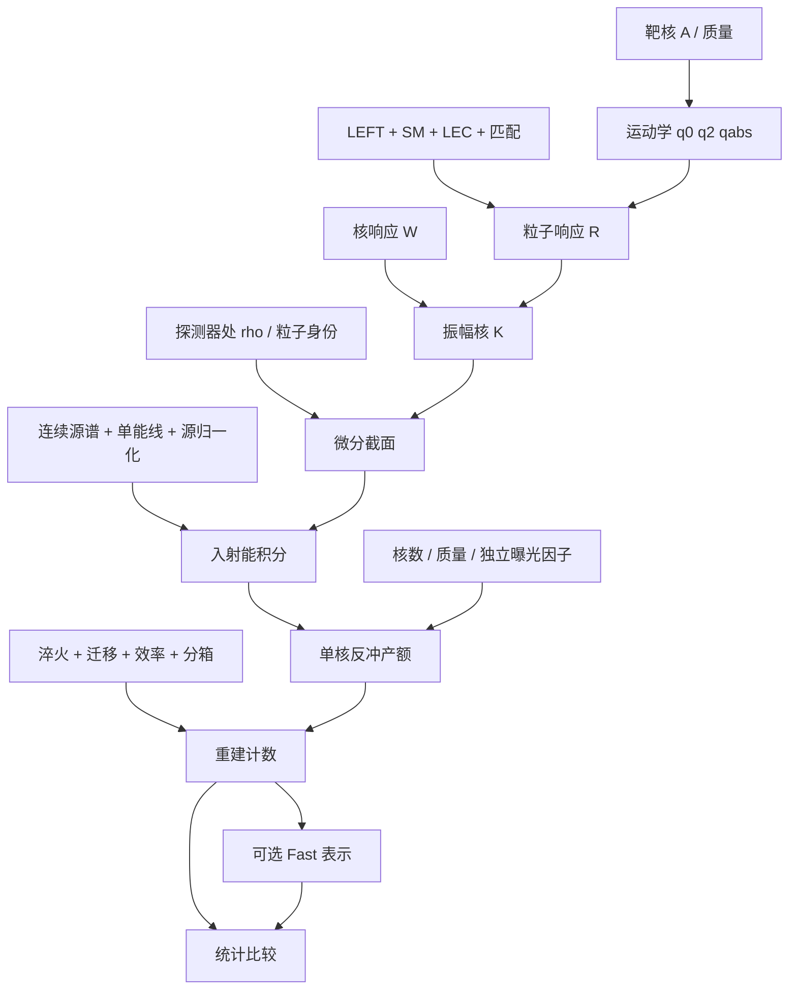

# 01 物理拆分、公式和模块契约

本文件定义“什么应当独立替换”。实际代码见 [02](02-current-code-map.md)，替换动作见 [03](03-replacement-playbook.md)。
模块 ID 是本 Skill 的物理索引，不是既有 workflow Phase 或新的运行 API。

## 1. 总计算式与依赖

时间积分注量版本的独立源分量 s、核素 A、探测器 d 的预测为

\[
N_{d i}=\sum_{s,A} n_{dA}\int dT\,\mathcal A_{diAs}(T)
\left[\int_{\mathrm{supp}(s)\cap[E_{\min}(T),\infty)}dE\,
\Phi^{\mathrm{cont}}_{ds}(E)\,\frac{d\sigma_A[\rho_{ds}(E)]}{dT}
+\sum_j F_{dsj}\,\frac{d\sigma_A[\rho_{dsj}]}{dT}(E_{dsj},T)\right].
\]

每条线还要施加自身运动学支撑。连续谱单位 cm^-2 GeV^-1；谱线权重 F 单位 cm^-2。
使用每秒 flux 时，将 Φ 换成 φ，并由曝光模块进行时间积分；不能同时乘已包含的 POT/运行期。
反冲、源能、重建量的求积变量若改为 MeV/keV，必须同步转换微分量及 Jacobian。

\[
\mathcal A_{diAs}(T)=a_{ds}\int_{x_i}^{x_{i+1}}dx\,
\epsilon_d(x)P_{dA}(x|T),\qquad
\int_{\mathrm{full\ domain}}dx\,P_{dA}(x|T)=1.
\]

接受率 a_s 只有在能量/时间相关选择可被可靠分离为常数时才能移出积分。
离散 PE 用概率质量与求和；连续 PE 近似用密度与积分。二者单位不同。

通用性是条件：同一实验中也可用多个源、多个靶、多个探测器、多个运行期。
它们是物理轴，应保留分量后求和；source component 轴不是振幅末态 flavor 轴。

## 2. C00 配置、单位与数值方法

- **对象**：dataset 身份、参数值、来源、单位、输出轴、计算精度；配置本身不产生事件。
- **输入/输出**：有来源的参数表 → 类型化的运行参数；无物理单位的设置也需标出作用域。
- **必须区分**：物理端点 Emax、表格覆盖区间、插值节点、积分节点、求积容差；不能相互代替。
- **当前**：Python 硬编码与 experiment.yaml 并存；部分 loader 仅作 spec 发现。逐字段证明谁实际读取。
- **替换**：改积分精度一般只改调用参数；改数据不一定改模型；改单位必须保持物理量值不变。
- **验证**：相同物理输入的 MeV/GeV 计算一致；增加求积点逐箱收敛；配置扰动实际影响预期运行量。

## 3. 源模块 S01–S05

### S01 连续谱形状

令 f_s(E) 为单位归一化形状时，应有 ∫f_s dE=1；若本身是绝对谱，不再乘总注量。
SNS 停止 μ+ 衰变产生 νe 与反νμ 两条 Michel 谱，其形状、截断和近似需要分别记录。
输出一个或多个分量的非负微分 flux/fluence；源函数不读取靶核、EFT、探测器效率或 bin。
仅换谱形不应改核响应或散射振幅。

### S02 源强、几何与时间基准

SNS 当前总注量：Φ0=r N_POT/(4πL_cm²)，每个衰变分量按其定义归一化。
几何 1/(4πL²) 只适用于所采用的点源各向同性近似；扩展源、束流方向性要独立模型。
反应堆可选探测器处绝对谱，或热功率/裂变率/产额/几何推导，两条归一化路线不可相乘。
**owner**：源可输出已含 POT 或时间的 fluence，也可输出每秒 flux；记录 exposure_included，
计数层只乘未含的时间/质量。既有 source Skill 的“禁止乘 exposure”与允许输出运行期 fluence
在措辞上需要核对具体合同；执行时明确列出已含 POT/时间的因子。若合同与实现冲突，交 Master
处理受影响的物理决定，不自行删除既有源归一化，也不重复乘运行时间。
改变基线还可能改变传播态，不能只按 L^-2 缩放而忽略振荡。

### S03 离散能线

Φ_line(E)=Σ_j F_j δ(E-E_j)。E_j 有能量单位，F_j 为积分权重，不是密度峰高。
SNS prompt νμ 的 E0=(mπ²-mμ²)/(2mπ)≈29.79 MeV；这是 π 衰变，与 μ 连续谱上限不同。
新源可无谱线或有多条线；积分器不得强制每个源都有 muLine，也不能把窄高斯宽度当物理事实。
每条线使用该能量处的 rho，并单独检查 T≤Tmax(E_j)。

### S04 支撑、插值与域外行为

μ 静止衰变端点 Emax=(mμ²-me²)/(2mμ)≈52.828 MeV。
当前 SNS loader 的 tabulation 0.001–300 MeV、node mask 到 56 MeV 和事件积分端点是三个不同对象。
这个旧复现约定不能写成理想物理谱严格到 56 MeV；线性插值最后一格可能有 taper。
替换源时规定插值类型、分段连续性、物理支撑、表格支撑、外推、缺点、积分精度。
旧积分器的 52.8 MeV 不能通过改 SNSDataset 的上限字段自动消除。

### S05 时间结构与源不确定度

时间分辨模型 φ_s(E,t) 与 fluence Φ_s(E) 是不同表示；ρ 的时间平均必须按 flux 加权。
源强、谱形、运行期相关性的不确定度作为独立参数/协方差传给统计层，不在源内重复 profile。
当前 COHERENT 路径是时间积分预测，固定 a_mu=0.997、a_e=a_mub=0.848；没有联合能量–时间事件积分器。
加入时间轴需要 P(x,t_rec|T,t)、时间效率、时间窗、束流时间轮廓和输出轴，不是多乘一个寿命因子。

## 4. 入射态模块 P01–P03

### P01 粒子身份

particle_kind∈{nu,antinu} 与 source ID 和 flavor 分开。相同 flavor 密度矩阵不能区分 ν/反ν。
当前标签仅作元数据，不能证明反中微子符号、螺旋度和系数共轭已经正确切换。
新反ν模型要有独立振幅及 ν/反ν benchmark；不根据字符串自动假定物理已实现。

### P02 Flavor 密度矩阵

在 (e,mu,tau) 基底，rho 为无量纲 Hermitian PSD 矩阵且 trace=1。
对角元为 flavor 概率，非对角元为相干；不能把概率向量当成相干振幅。
纯态 rho=a a†；不相干混合 rho=diag(p_e,p_mu,p_tau)。
允许 (3,3) 常量或 energy_shape+(3,3)；各源独立归一化，不能把通量幅值塞进 rho。
NeutrinoState 只记录 shape，不记录 E 值；同 shape 的不同能量网格仍可能错配。
连续谱筛选 E≥Emin 后，rho 必须同步切片，或直接在实际子网格重新计算；谱线另行取值。

### P03 传播

传播后端输入源态、能量、路径、介质和传播物理参数，输出探测器处 rho(E)，不输出 CEvNS 事件率。
当前 PropagationState 保存 energy_GeV 与 rho，SNuDD adapter 只包装外部 density 计算器。
传播 NP 参数与检测 NP 参数的关联必须由物理模型声明。当前 vector NSI 转换只接受 NP-only 的 C6u1/C6d1，
因为传播 Hamiltonian 已含 SM；检测层仍按自己的开关加入 SM。
若 rho 随扫描 Wilson 改变，必须重算传播；固定 rho 的已积分系数快核不自动适用。

## 5. 靶核与曝光 T01–T03

### T01 材料与同位素数

质量分数 w_A：n_A=M_kg w_A/(m_A,kg)。数分数 f_A 需先转换质量分数，不能互换。
若用摩尔质量 g/mol，则 n_A=1000 M_kg w_A N_Av/M_A；所有质量单位需一致。
CsI 等数目的 Cs/I 对应 w_Cs=133/260、w_I=127/260；不是各 1/2 的质量分数。
当前代码近似 m_A,kg=A×1.6605390666e-27；核运动学质量为 A×AMU_GEV，不是精确逐同位素核质量。
更换质量约定需同时核对运动学、核数和 Fast，不能仅改一个转换常数。

### T02 有效质量、活时间、曝光

可选 M×t 或已合并 exposure，不能同时使用。fluence 情况只再乘质量；flux 情况需要时间积分。
探测器质量影响归一化，活时间影响曝光，dead time/运行选择属于明确的时间效率或曝光定义。
当前 SNSDataset 混放质量、基线、POT；这是旧代码布局，不是推荐模块边界。
多探测器、多运行期应分别保留质量、源位置与曝光，不自动平均成一个 effective detector。

### T03 核响应输入与核结构

W_X(y) 来自核多体矩阵元，不是探测器迁移矩阵。y=(|q|b/2)²；b 为 GeV^-1，q 为 GeV。
当前数据库以 (p,n) 的 2×2 矩阵存多项式：exp(lambda*y)Σ_n a_n y^n，当前 lambda=-2。
W^01=B^T W^pn B，B=[[1,1],[1,-1]]，匹配 c0=(cp+cn)/2、c1=(cp-cn)/2。
换核模型应保持算符截断、基底、符号、multipole 和 normalization；否则同时适配振幅收缩。
程序不在运行时做 shell model/OBDM/单粒子矩阵元生成；只有聚合表不等于来源验证完整。

## 6. 相互作用与截面 E01–E08

### E01 LEFT 算符与 Wilson 输入

输入 hat C 的质量维数为 4-d，矩阵行是末态 alpha、列是初态 beta。
当前 active registry 为 22 个 d=5–8 结构；constants 中更长理论清单不等于全部可执行。
缺失的已支持系数在匹配中取零；未知键应拒绝。显式区分 NP-only 与 SM+NP 输入。
UV→SMEFT→LEFT 的公式字符串属于背景元数据；当前 COHERENT 数值链从 LEFT 开始。
扩展算符需更新 registry、matching、R、Fast basis 和验证，不能只加一个名称。

### E02 SM 与 NP 合并

SM d=6 项在 flavor 空间为单位阵倍数，在双线性之前加到 NP。
当前 C6u1=−GF/√2(1−8sW²/3)，C6d1=+GF/√2(1−4sW²/3)，
C6u2=+GF/√2，C6d2=−GF/√2，均乘 I3；轴流排序改变时需重查符号。
对纯入射 flavor，只有相同物理末态的振幅干涉；相干入射态可能通过非对角 rho 保留其他干涉。
相互独立产生的 SNS 源分量只加事件数，不在不同源分量之间加振幅。

### E03 Hadronic LEC 与长程项

LEC 将非微扰 hadronic 物理编码为常数。已知值、估计值和 NDA 假设要分别记录来源与不确定度。
当前 L1–L4、g5–g9 无量纲；B0m_u/d 为 GeV²；L5–L14、g1–g4、sigma 和质量为 GeV。
光子极点 1/q²、pion pole 1/(mπ²−q²) 的 q² 是 Lorentz invariant，不是正的 |q|²。
零动量安全分支不是普遍的红外物理结论；新长程模型要定义阈值/正则化与积分支撑。

### E04 LEFT 到核子算符

left_to_ci 线性输出 14 对 cp,cn flavor 矩阵及 isoscalar/isovector 组合。
例如 cp1|d6=2C6u1+C6d1，cn1|d6=C6u1+2C6d1；同一输入还可能进入 c5/c6 等项。
当前 c1–c12 为 GeV^-2，c13–c14 为 GeV^-3。选择 quark_mass_resolved/legacy c10 是物理约定，需显式记录。
更换 LEC 或匹配时，应经核心函数显式传参到所有调用方；不能只重绑 DEFAULT_LECS，
因为默认参数可能已绑定对象，Fast 也直接使用自己的默认入口。

### E05 弹性运动学与动量定义

对静止、弹性、忽略中微子质量的靶：

\[
T_{max}=\frac{2E^2}{m_A+2E},\quad
E_{min}=\frac{T+\sqrt{T^2+2m_AT}}2,\quad
q^0=T,\quad q^2=-2m_AT,\quad |q|^2=2m_AT+T^2.
\]

当前振幅实现取 |q|²≈2m_AT，再用 q²=(q0)²−|q|²；这得到 T²−2m_AT，
与精确弹性 invariant 相差 T²。精确支撑边界与低反冲响应近似应分开说明。
将 q0/q2/qabs2 同时传参不等于它们全部是精确值。更改运动学精度要统一 Slow/Fast 的参数构造。
非弹性、电子散射、有限中微子质量不属于当前公式的无条件复用范围。

### E06 粒子响应 R 与 flavor 双线性

(ci†cj)_(beta,beta')=Σ_alpha ci*_(alpha,beta)cj_(alpha,beta')，输出核是入射 flavor 空间矩阵。
按 LNC/LNV sector 求和，不对正交末态制造干涉。当前 LNV 系数校验只强制零对角，
不能声称已经强制完整 flavor 反对称；也不能由此推论所有 LNV 算符物理上均须零对角。
当前 R_SigmaPDelta=0。更改该响应必须同时改 Slow 与 Fast 的公式及测试。

### E07 振幅核 K 与核响应收缩

K 是 3×3 flavor 矩阵，当前 adopted normalization 下为 GeV^-2。
现代码按通道将 R_(3,3,2,2) 与 W_(2,2) 收缩，MPhiPP 取 Hermitian 部分。
不能未经证明把 reference 公式的 4π/(2J+1)、q²/mN²、−2q/mN 再乘到当前代码，
也不能说它们一定已被数据库吸收。外部规范审计尚未闭合，见项目 audit 文档。
换 W 归一化或混合通道排序属于 K/W 两层共同契约，不是简单替换数字表。

### E08 微分截面、入射态收缩与单位

当前 dσ/dT=mA/(8πE²) Tr(rho K)。自然单位 GeV^-3，乘 GEV_INV2_TO_CM2 得 cm²/GeV，
再乘 1e-6 得 cm²/keV。源单位若为 cm^-2 MeV^-1，则能量积分变量必须是 MeV。
理论 core 以 GeV 入射能、keV 反冲接口；rates wrapper 以 MeV 入射能；不能只看函数名称推断单位。
超出运动学支撑返回零；零能网格端点由 rates 跳过；core 的非正能输入不应被静默接受。

## 7. H01 Helm 比较模型

Helm 的核弱荷矩阵与单个 form factor 是独立的近似描述，不是完整多通道 W 的额外乘数。
当前提供 scalar SM 和 flavor-matrix vector 接口；先检查其支持的相互作用空间。
切换 kinematics='mathematica'/'exact_vector' 要记录其物理差别和端点行为。
不能以 Helm 对任意 LEFT 算符的替代宣称完整 EFT 支持。

## 8. 探测器模块 D01–D05

### D01 平均响应 / 淬火 / yield

mu_A(T) 将真反冲能映射到重建量，输入 keVnr、输出 keVee/PE 等必须写清。
当前 CsI2021 的 eee_quenching_csi 是经验多项式；CsI2017 用 PE=1.17*T_keV；Ar 使用另一平均映射。
模型可由标定表代替，需覆盖实际 T 范围并记录温度/材料/运行期。
平均映射不是单次事件的观测值，不应把 ε(mu(T)) 当成与 ∫ε(x)P(x|T)dx 一般等价。

### D02 分辨率 / 重建概率

P(x|T) 是给定 T 的条件密度或概率质量。全域积分为 1；分析窗口外概率自然丢失。
CsI2021 使用 gamma 密度；CsI2017 delta 映射需要 1/|dx/dT| Jacobian；Ar 当前宽度写成 x 的函数，
不能未经验证称其为对所有 T 严格归一化的标准高斯。
高斯、Poisson、gamma、经验迁移矩阵各自需检查平均值/宽度/概率解释。
迁移矩阵必须注明是否已经含 bin 积分、效率、触发、阈值；不能重复施加。

### D03 效率

ε 以真 T、平均 x、重建 x 或时间为自变量的含义不同；记录作用位置、范围及不确定度。
通常 0≤ε≤1；若资料给 effective acceptance，其因子化和上界需按实际定义验证。
效率表的单位、插值、低于阈值、超出标定区间行为不能由默认外推猜测。

### D04 选择接受率与时间

CsI2021 的 a_s 是每源分量选择接受率，与 PE 效率不同。先检查选择是否已包含在 fluence/response 中。
若选择随 E/T/x/t 改变，就保留在相应积分内。背景选择和信号选择不能自动共用。

### D05 分箱与观测量

events/bin 是积分值，counts/PE 是 bin 平均密度 N_i/ΔPE_i，不是中心点微分值。
改变 bin edges 需同步响应积分、Fast 轴、数据/背景/协方差和绘图；不能只改横坐标标签。
不同 observable 的变换需要 Jacobian 或正确积分，不能把 PE bins 直接命名 keVee。
时间联合 bins 需要新的轴契约，现有一维结果无法仅 reshape 成二维物理预测。

## 9. 事件积分 I01–I04

### I01 入射能积分

对连续源算 Φ(E)dσ/dT，对每条线直接求值乘权重，统一粒子类别、rho 和支撑。
能量数值误差与源表插值误差应分别检查；谱端点、阈值、分段节点是需要解析处理的点。
避免逐 PE 重复求同一反冲谱：固定输入时可先算 Y_A,s(T)，再做 detector fold。
这种重排在数学上可因线性复用，但须先证明与旧插值/求积约定等价。

### I02 反冲到观测 bin 的折叠

给出 A_i(T)=∫bin εP dx，随后算 ∫Y(T)A_i(T)dT；或先算重建谱再分箱。
两种顺序在连续、线性且收敛时等价，有限网格插值不保证逐位相同。
表明 response matrix 是否含 dT 权重、核数、质量、效率；一个矩阵中每种因子只归一处。

### I03 核数/曝光与分量汇总

可先算每核、每 kg 或整台探测器产额，但中间对象名称和单位要明确。
当前 CsI2021 raw 已乘整台 14.57 kg，尚未乘 133/260、127/260 和 a_s；
raw 不是已经按真实同位素质量分配的最终贡献。后续不能再给它乘一次整台质量。
不同靶和源是概率/计数求和；核子 p/n 振幅干涉已经在 K 中，不能与靶同位素求和混淆。

### I04 输出与科学含义

输出包含 bin edges/unit、counts、源/靶/探测器分量、理论参数、积分精度、归一化 metadata。
源变化只允许改变由其依赖产生的输出；诊断保留 source→dY/dT→dN/dx→N_i 的检查点。
一个总数不能证明谱形正确；纯 SM 回归也不能验证复系数与 flavor 干涉。

## 10. Fast F01–F04

F01 是未积分的系数空间 h_A,IJ(E,T)；F02 是含源、靶、探测器、曝光及 bin 的积分 H。
K、h、H、W、探测器响应矩阵是不同对象，不能都叫“kernel”而省略轴和单位。
对固定、能量无关 rho_s：B_s,IJ=Tr(rho_s C_I†C_J)，N_i=Re Σ_sIJ H_s,i,IJ B_s,IJ。
一般 rho(E) 要在能量积分内收缩或保留更高维 transfer tensor。
F03 重建只随允许扫描的系数改变；完整 basis 和 sector 规则必须与 Slow 一致。
F04 缓存标识需反映实际积分过的输入；存储器能读出 shape 不等于源/探测器物理版本仍一致。
pair_im 当前存 −Im(H_IJ)，重建用 +2 Im(B_IJ)*pair_im；单独改其中一个符号会出错。
各 H_IJ 因 operator dimension 不同可能有不同的单位幂；不能笼统给所有 H 元素同一单位而不说明系数尺度。

## 11. 统计 L01–L03 与路由 O01

L01 观测数据先区分 raw counts、on/off、减背景 excess、unbinned 数据；负 excess 不等于负 Poisson 事件。
背景、误差条、协方差、binning 和 provenance 是独立数据模块；换数据不应修改源谱或 dσ/dT。
L02 likelihood/χ² 与 nuisance 的定义独立于 forward model；相关系统误差不能在联合分析中被误当独立。
L03 profiling/scan、自由度与区间阈值需按问题选择，不能以一个 χ² 最小值代替覆盖率论证。
当前 COHERENT stats 标为 legacy approximate，不因此自动成为官方 likelihood。
O01 registry 只负责发现/分发；新增名字不实现物理，spec 存在不证明 Slow/Fast 支持。
绘图模块读取有单位和轴的物理输出，不应成为唯一保存归一化、背景或修正因子的地方。
