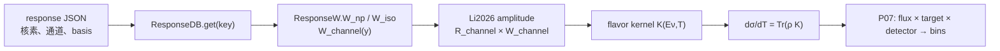

# P04 核响应：现有代码的核心结构与可运行例子

配合 [P04 填写模板](P04_THEORY_RESPONSE_TEMPLATE.md) 使用。本文件以当前 CsI2021 的核响应调用为实例，展示**真实公共 API、必要的内部计算和新实验的接入边界**。它不是另一个核响应实现，也不把 CsI 参数设为通用默认值。下面的代码片段均来自或调用当前仓库；完整实现以所列源码为准。

## 1. 数据与调用框架

| 层 | 当前文件 / 核心 symbol | 输入 → 输出 | 新实验的责任 |
| --- | --- | --- | --- |
| 核响应数据 | [`data/responses/responses_all.json`](../../../../data/responses/responses_all.json) | `nuclei[key].basic`、`exp_factor`、`responses[channel]` | 核对来源、同位素、basis、通道、`A/Z/N/b` 和有效域 |
| 装载与选择 | [`nuclear/response.py`](../../../../src/cevns_pyeft/nuclear/response.py) 的 `ResponseDB.get` | JSON 路径、response key → `ResponseW` | 显式给每个同位素的 key；不要从名字猜 |
| 计算 `W` | 同文件的 `ResponseW.W_np/W_iso` | channel、无量纲 `y` → 标量或 2×2 矩阵 | 核对 p/n 基底、`y=(qb/2)^2`、参数单位 |
| 理论收缩 | [`theory/li2026/amplitude.py`](../../../../src/cevns_pyeft/theory/li2026/amplitude.py) 的 `_get_W_matrix`、`flavor_kernel_onebody_li2026` | `W`、Wilson/matching 和运动学 → flavor 振幅 kernel | 确认所需 channel 都已实现，且理论模型适用 |
| 截面边界 | [`rates/differential.py`](../../../../src/cevns_pyeft/rates/differential.py) 的 `differential_flavor_kernel_nn`、`differential_cross_section_nn` | `resp,E_R,Eν,ρ` → `cm²/keV` | 核对 flavor、ν/反ν约定、单位和运动学支撑 |
| 逐箱编排 | [`slow_counts_csi2021.py`](../../../../src/cevns_pyeft/experiments/coherent/slow_counts_csi2021.py) | 各同位素 `ResponseW` → 各自计数，再按靶组成汇总 | 同位素权重属于 P02/P07，不能写进 `ResponseW` |



**边界**：`ResponseW` 是**核**响应；P06 的能量分辨率/效率是**探测器**响应。`ResponseDB.get` 不计算通量、靶核数、曝光或逐箱计数。

## 2. 从现有源码提取的核心代码

响应表将每个矩阵元存成 `y` 的多项式系数，外乘 `exp(exp_factor × y)`。[`ResponseW.W_np`](../../../../src/cevns_pyeft/nuclear/response.py) 的关键逻辑可压缩为：

```python
def _poly_eval(coeffs, y):
    value = 0.0
    for coefficient in reversed(coeffs):
        value = value * y + float(coefficient)
    return value

# 对 2×2 核响应表中的每个矩阵元：
W_ij_y = _poly_eval(coefficients_ij, y) * math.exp(exp_factor * y)
```

这段是**结构摘录**，`coefficients_ij`、`exp_factor`、`y` 来自当前对象/运动学，不能孤立执行。实际代码的 `W_np(channel,y)` 同时处理标量响应与 2×2 矩阵，并对缺失 channel 抛出 `KeyError`。`W_iso` 在取 `W_np` 后做基底变换；振幅层 `_get_W_matrix` 按所选 basis 取矩阵，若该 channel 只有标量而理论要求 2×2，则抛出 `TypeError`。

关键物理关系是：

```text
q_abs[GeV] = sqrt(2 m_A[GeV] E_R[GeV])
y = (q_abs[GeV] · b[GeV^-1] / 2)^2           # 无量纲
W_channel(y) = exp(exp_factor · y) · polynomial_channel(y)
K_flavor(Eν,T) = Σ_channel R_particle(channel) : W_nuclear(channel,y)
dσ/dT = Tr[ρ(Eν) K_flavor(Eν,T)]             # rates API: cm²/keV
```

`Li2026` 振幅层当前映射 `M`、`SigmaPP`、`SigmaP`、`PhiPP`、`PhiPT`、`Delta`、`MPhiPP`。若输入表存在 `SigmaPDelta`，当前该项在振幅结果中置零；需要该非零贡献的目标不能判定当前实现可直接复用。完整核响应路径不再额外乘 Helm。

## 3. 可运行的最小调用示例

在仓库根目录、已安装项目或设置 `PYTHONPATH=src` 后，把下面代码粘贴进 Python 运行。它使用**实际公共 API**，只演示核响应装载、矩阵检查和单个截面点；没有源通量、曝光或探测器折叠。

```python
import numpy as np

from cevns_pyeft.nuclear.response import ResponseDB
from cevns_pyeft.rates.differential import differential_cross_section_nn
from cevns_pyeft.sources.state import pure_flavor_state

db = ResponseDB("data/responses/responses_all.json")
assert db.meta["basis"] == "np"  # 表中的 2×2 顺序实际为 (p,n)

response_keys = {"Cs133": "Cs133", "I127": "I"}
for isotope, key in response_keys.items():
    resp = db.get(key)
    assert int(resp.get_basic("A")) > 0
    assert float(resp.get_basic("b")) > 0
    w_m_zero = np.asarray(resp.W_np("M", 0.0), dtype=float)
    assert w_m_zero.shape == (2, 2)
    print(isotope, key, w_m_zero.shape)

resp_cs = db.get("Cs133")
state = pure_flavor_state("mu", particle_kind="nu")
result = differential_cross_section_nn(
    resp_cs,
    ER_keV=1.0,
    Enu_MeV=30.0,
    rho=state,
    include_sm=True,
)
print("dSigma/dT [cm^2/keV] =", result.dsigma_cm2_per_keV)
```

本次在当前工作区执行其中的 Cs133 计算，得到 `W_M(0)` 形状 `(2,2)`、`A=133`、`dσ/dT=2.6294471976196254e-39 cm²/keV`。该值只证明**这组代码和参数在当前实现可运行**，不构成新实验的物理基准。

## 4. 新实验应复用什么、补什么

| 条件 | P04 决策 | 最小实现动作 |
| --- | --- | --- |
| JSON 格式、basis、核素 key、所需 channel 和理论模型都适用 | 候选 `REUSE` / `CONFIG_ONLY` | 在新实验配置中列 `response_file` 与逐同位素 `response_key`；直接调用 `ResponseDB.get` |
| response key 只需从实验同位素名映射到表内名字 | `ADAPTER` | 在实验层保留显式映射，如 CsI2021 的 `I127 → I`；不要改公共数据库去猜核素 |
| 表格已有而公共装载器不支持其格式，但物理定义相同 | `ADAPTER` 或 `SHARED_EXTENSION` | 写一次有版本与单位检查的数据转换；不能静默用默认 `exp_factor` |
| 缺所需核素、通道或核响应系数 | `BLOCKED` | 向用户索取源表与来源，不用邻近核素或 Helm 自动补 |
| 目标模型需要当前振幅中未实现的非零项或不同 ν/反ν kernel | `CORE_EXTENSION` 或 `BLOCKED` | 先作物理审计，再设计共享扩展及既有实验回归 |

建议的实验层最薄结构是 `dataset 配置中的 isotope → response_key 映射 → ResponseDB.get → 共享截面 API`；同位素丰度、质量和曝光由 P02/P07 负责。`ResponseDB` 内部已有按 key 缓存，无需为每个源分量重复解析 JSON。

## 5. 必须检查的边界

1. **基底顺序**：JSON `meta.basis` 写 `np`，注释和 [现有测试](../../../../tests/test_nuclear_response_convention.py)确认 2×2 矩阵的物理顺序为 `(p,n)`。不能把函数名中的 `np` 误读为矩阵顺序 `(n,p)`。
2. **`b` 与 `y` 的单位**：`q` 为 GeV，当前 `b` 为 GeV⁻¹；`y` 无量纲。新表要给出 `b` 的来源和单位。
3. **key 与通道**：`Cs133` 与 `I` 是当前表中实际 key；`I127` 是实验层名称。对每个目标检查 `resp.keys()` 与振幅所需通道。
4. **表格残差**：当前 [核响应约定测试](../../../../tests/test_nuclear_response_convention.py)刻意保留碘 `M` 通道 `q=0` 归一化残差，直到源表审计；不能把它静默“修正”为精确 `N²`。
5. **ν/反ν**：当前 `NeutrinoState.particle_kind` 保留标签，但交互 kernel 的反中微子符号/螺旋度差别尚需独立物理审计；不能仅凭标签宣称完整反中微子实现。
6. **Gate**：该示例不代表 P04 通过。新实验必须提交核响应来源、模型适用域、所需 channel、共享测试及 Human Physics Approval。

## 6. P04 填写范例：用户资料到代码动作

| 用户在 P04 模板提供 | AI 在代码栏记录 |
| --- | --- |
| “天然 Ge；各同位素丰度见表 2；核响应数据文件为……；采用项目 Li2026 EFT；需要 M 和其他所列通道” | 逐同位素列 `response_key`、文件版本、`A/Z/N/b`、`resp.keys()`；先核对是否真的覆盖天然同位素 |
| “采用 (p,n) 核响应，flavor 依论文公式……” | 核对 JSON basis、`W_np` 与 coefficient basis；检查 `ρ(Eν)` 轴及 ν/反ν约定 |
| “若缺某个同位素响应” | 该目标的 P04 标 `BLOCKED`，写明缺哪个 key/channel 和可取得的数据；不沿用 Cs133/I 或 Ge73 代替 |

用户不需要把源码贴进 P04 表格；应提供**模型、核素、数据来源和可比较数值**。AI 再依据本例填写真实 symbol、复用分类和最小实施方案。
