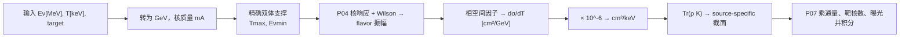

# P05 运动学与微分截面：现有代码框架和可运行例子

配合 [P05 填写模板](P05_KINEMATICS_CROSS_SECTION_TEMPLATE.md) 使用。本文件从当前项目提取**精确弹性双体支撑、截面计算边界、单位桥和 flavor 收缩**；CsI2021 的 Cs133 参数点只用作代码示范。新实验必须按自己的模型、靶核和数据来源填写 P05。

## 1. 当前调用链与职责边界

| 层 | 当前源码与 symbol | 输入 → 输出 | P05 核对项 |
| --- | --- | --- | --- |
| 基础单位 | [`foundation/constants.py`](../../../../src/cevns_pyeft/foundation/constants.py)；[`foundation/units.py`](../../../../src/cevns_pyeft/foundation/units.py) | `MeV/keV ↔ GeV`；`cm²/GeV → cm²/keV` | 转换只做一次，明确积分变量的单位 |
| 弹性支撑 | [`theory/kinematics.py`](../../../../src/cevns_pyeft/theory/kinematics.py) | `Eν,mA → T_max`；`T,mA → Eν_min`；点是否允许 | 精确双体边界与非法输入行为 |
| 核响应/振幅 | [`theory/li2026/amplitude.py`](../../../../src/cevns_pyeft/theory/li2026/amplitude.py) | `resp,Wilson,Eν,T → 3×3 flavor 振幅 kernel` | P04 模型、Response key 与通道已获批准 |
| 理论截面 | [`theory/li2026/cross_section.py`](../../../../src/cevns_pyeft/theory/li2026/cross_section.py) | flavor kernel + 相空间因子 → `cm²/GeV` | 不在此层乘通量、靶核数或曝光 |
| 率接口 | [`rates/differential.py`](../../../../src/cevns_pyeft/rates/differential.py) | `ER_keV,Enu_MeV,resp,ρ` → `DSigmaResult.dsigma_cm2_per_keV` | flavor/ν反ν、标量/数组轴、单位 |
| 参考比较 | [`theory/helm/cross_section.py`](../../../../src/cevns_pyeft/theory/helm/cross_section.py) | 指定 SM Helm 模型和运动学选择 → 截面 | 仅在科学目标允许时作为单独比较路线 |



P05 **不加载源谱、不乘探测器质量/曝光、不施加效率、不分箱**。这些属于 P03、P02、P06 和 P07。

## 2. 从真实实现提取的核心公式

[`theory.kinematics`](../../../../src/cevns_pyeft/theory/kinematics.py) 使用精确弹性双体公式：

```text
T_max(Eν) = 2 Eν² / (m_A + 2 Eν)
Eν_min(T) = [T + sqrt(T² + 2 m_A T)] / 2
allowed(Eν,T) = (0 ≤ T ≤ T_max(Eν))
```

公式内 `Eν`、`T`、`m_A` 均为 GeV。当前质量约定在截面包装层是 `m_A = A × AMU_GEV`；若新材料要求精确核质量，需先核对现有公共接口是否可表达，不能只换 `A` 值冒充另一质量约定。

核心代码逻辑是：

```python
def two_body_recoil_max_GeV(E_nu_GeV, m_A_GeV):
    energy = _positive_finite(E_nu_GeV, name="E_nu_GeV")
    mass = _positive_finite(m_A_GeV, name="m_A_GeV")
    return 2.0 * energy * energy / (mass + 2.0 * energy)

def minimum_neutrino_energy_GeV(ER_GeV, m_A_GeV):
    recoil = _nonnegative_finite(ER_GeV, name="ER_GeV")
    mass = _positive_finite(m_A_GeV, name="m_A_GeV")
    return 0.5 * (recoil + math.sqrt(recoil * recoil + 2.0 * mass * recoil))
```

以上是现有两函数的核心代码摘录；依赖同文件中的输入校验 helper，应从**现有模块导入**，不要复制为新实验函数。`is_two_body_recoil_allowed` 对合法但超端点的点返回 `False`；对 `Eν≤0`、负反冲或非有限输入报错。率层 `differential_flavor_kernel_nn` 特别允许积分网格中的 `Eν=0` 节点并返回零 kernel，这不改变理论核心的输入要求。

截面的关键次序是：

```text
P04 振幅 kernel A(Eν,T) [3×3]
→ phase-space prefactor m_A/(8π Eν²) × GEV_INV2_TO_CM2
→ dK/dT_GeV [cm²/GeV, 3×3]
→ × 10^-6 = dK/dT_keV [cm²/keV, 3×3]
→ Tr[ρ(Eν) dK/dT_keV] = dσ/dT_keV
```

`× 10^-6` 来自 `dT_GeV/dT_keV`，由 `cm2_per_GeV_to_cm2_per_keV` 负责。积分时若使用 keV 轴，必须配 `cm²/keV`；若使用 GeV 轴，配 `cm²/GeV`，不能重复转换。[现有单位测试](../../../../tests/test_li2026_units_contract.py)包含两种积分的等价检查。

## 3. 可运行的当前 API 示例

在仓库根目录、已安装项目或设置 `PYTHONPATH=src` 后执行以下完整代码。这里选当前 CsI2021 使用的 Cs133，`Eν=30 MeV` 和 `T=1 keV`；数值仅用于核查接口与边界。

```python
import math
import numpy as np

from cevns_pyeft.foundation import constants as c
from cevns_pyeft.foundation.units import cm2_per_GeV_to_cm2_per_keV
from cevns_pyeft.nuclear.response import ResponseDB
from cevns_pyeft.rates.differential import (
    differential_cross_section_nn,
    differential_flavor_kernel_nn,
)
from cevns_pyeft.sources.state import pure_flavor_state
from cevns_pyeft.theory.kinematics import (
    is_two_body_recoil_allowed,
    minimum_neutrino_energy_GeV,
    two_body_recoil_max_GeV,
)

resp = ResponseDB("data/responses/responses_all.json").get("Cs133")
mass_GeV = int(resp.get_basic("A")) * c.AMU_GEV
energy_GeV = 30.0 * c.MeV
endpoint_GeV = two_body_recoil_max_GeV(energy_GeV, mass_GeV)
inverse_GeV = minimum_neutrino_energy_GeV(endpoint_GeV, mass_GeV)

assert math.isclose(inverse_GeV, energy_GeV, rel_tol=1e-12)
assert is_two_body_recoil_allowed(energy_GeV, endpoint_GeV, mass_GeV)
assert not is_two_body_recoil_allowed(
    energy_GeV, 1.01 * endpoint_GeV, mass_GeV
)
assert cm2_per_GeV_to_cm2_per_keV(1.0) == 1e-6

state = pure_flavor_state("mu", particle_kind="nu")
inside = differential_cross_section_nn(
    resp, ER_keV=1.0, Enu_MeV=30.0, rho=state, include_sm=True
).dsigma_cm2_per_keV
outside = differential_cross_section_nn(
    resp, ER_keV=1.01 * endpoint_GeV / c.keV,
    Enu_MeV=30.0, rho=state, include_sm=True,
).dsigma_cm2_per_keV
kernel = differential_flavor_kernel_nn(
    resp, ER_keV=1.0, Enu_MeV=np.array([0.0, 30.0]),
    include_sm=True,
).kernel_cm2_per_keV

assert inside > 0.0 and outside == 0.0
assert kernel.shape == (2, 3, 3)
assert np.all(kernel[0] == 0.0)  # 率积分网格的零能端点
print("Tmax [keV] =", endpoint_GeV / c.keV)
print("Emin(Tmax) [MeV] =", inverse_GeV / c.MeV)
print("dSigma/dT [cm^2/keV] =", inside)
```

本次运行结果：`Tmax=14.522135130310854 keV`，`Eν_min(Tmax)=30 MeV`，域外截面为零，`kernel.shape=(2,3,3)`，`dσ/dT=2.6294471976196254e-39 cm²/keV`。这些值是**当前模型的代码示例**，不是新实验的外部物理基准。

## 4. 单独的 Helm 比较分支

当前 [Helm 模型](../../../../src/cevns_pyeft/theory/helm/cross_section.py)提供 `dsigma_dER_helm_cm2_per_keV`；其 `kinematics` 参数有 `"mathematica"`（旧 Mathematica 近似因子）和 `"exact_vector"` 两种定义。两者都使用共享的**精确双体支撑**，但允许域内的截面公式不同。因此用户须在 P05 表中提供论文/旧代码对运动学因子的定义，AI 不得凭名称自行选定。

```python
from cevns_pyeft.theory.helm.cross_section import dsigma_dER_helm_cm2_per_keV

for convention in ("mathematica", "exact_vector"):
    value = dsigma_dER_helm_cm2_per_keV(
        30.0, 1.0, 133, 55, kinematics=convention
    )
    print(convention, value)
```

该分支是明确指定的 **SM/Helm 比较模型**，不能在完整 nuclear response 截面之后再乘 Helm form factor，也不能静默拿它替代一般 EFT 截面。

## 5. 新实验的复用判断

| 新实验条件 | 决策 | 代码动作 |
| --- | --- | --- |
| 精确弹性双体运动学、当前 `A × AMU_GEV` 质量约定及 Li2026 截面都适用 | 候选 `REUSE` | 复用 `theory.kinematics` 与 `rates.differential`；新实验只提供靶、入射状态和已批准参数 |
| 只有输入单位或实验调用形式不同 | `ADAPTER` | 在实验层作有名字的 MeV/keV/GeV 转换及薄 wrapper；不复制截面核心 |
| 只要求 SM Helm 复现，且资料明确其运动学因子 | `CONFIG_ONLY` 或 `ADAPTER` | 单独路由 `theory.helm`，记录 `mathematica/exact_vector` 选择 |
| 要求精确核质量、非弹性过程、额外运动学项或不同核相互作用 | `SHARED_EXTENSION / CORE_EXTENSION` 或 `BLOCKED` | 明确公式与来源后设计公共扩展，运行既有实验回归 |
| 缺入射能/反冲定义、质量约定或比较基准 | `BLOCKED` | 向用户定向索取资料，不以 CsI 的参数填空 |

用户在 P05 表里主要提供**过程、变量单位、模型公式和来源、核质量约定、基准点**。AI 负责把它们映射到现有 `theory.kinematics`、`rates.differential` 或独立 Helm 分支，并给出逐函数复用结论。

## 6. P05 验证清单

1. 端点 `Tmax` 与逆函数 `Eν_min(Tmax)` 一致；`T=0`、小反冲、端点、端点上方、非法输入分开检查。
2. `dσ/dT` 的数值单位与积分轴匹配；核心 `cm²/GeV` 到率层 `cm²/keV` 只转换一次。
3. 标量 `Eν` 的 flavor kernel 为 `(3,3)`；数组 `Eν` 为 `Eν.shape+(3,3)`；`ρ(Eν)` 的能量轴必须匹配。
4. SM、EFT、Helm 比较模型的有效域分别记录；ν/反ν物理差别仍须独立审计。
5. [现有 flavor 测试](../../../../tests/test_rates_differential_flavor.py)与[单位测试](../../../../tests/test_li2026_units_contract.py)是相关回归；P05 Machine Gate 还需要新实验自己的基准点和 Human Physics Approval。
