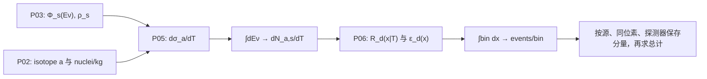

# P07 Slow 逐箱计数：现有代码与直接积分框架

配合 [P07 填写模板](P07_SLOW_COUNTS_TEMPLATE.md) 使用。这里从 CsI2021 实现提炼**源、靶、截面、探测器和分箱的编排结构**。示例使用很小的数值网格，仅证明 API 与输出轴；它不能成为权威 Slow 参考。

## 1. 真实调用链和归一化 owner

| 层 | 当前文件.symbol | 在 CsI2021 中负责 |
| --- | --- | --- |
| SNS 源与 flavor 状态 | [`coherent/sns.py`](../../../../src/cevns_pyeft/experiments/coherent/sns.py) 的 `loadNeutrinoEmpiricalFluxSNS`、`sns_component_state` | prompt `mu`、delayed `e/mub`；当前源是时间积分注量 |
| 靶核 Response | [`nuclear/response.py`](../../../../src/cevns_pyeft/nuclear/response.py) 的 `ResponseDB.get` | `Cs133 → Cs133`、`I127 → I` |
| 微分截面 | [`rates/differential.py`](../../../../src/cevns_pyeft/rates/differential.py) 的 `differential_cross_section_nn` | `cm²/keV`；按源分量的 `ρ` 收缩 |
| 真反冲率与探测器折叠 | [`rates/counts.py`](../../../../src/cevns_pyeft/rates/counts.py) 的 `_rate_per_kg`、`empirical_dNdPE_response_csi`、`bin_events_csi` | 积分 `Eν`，除单核质量得每 kg 率，再折叠成 PE 并积分 bin |
| CsI2021 编排 | [`slow_counts_csi2021.py`](../../../../src/cevns_pyeft/experiments/coherent/slow_counts_csi2021.py) 的 `slow_counts_csi2021` | 逐源/逐靶调用、按 Cs:I 组成混合、分量接受率、总和 |



对新实验，先填 P07 的归一化台账：`Φ` 是每秒通量还是已积分注量、`dσ/dT` 的单位、同位素数/kg、靶质量、活时间是否已在 `Φ` 中、响应/效率与 bin 的单位。当前 CsI2021 的时间积分注量只再乘质量，不能重复乘运行时间。

## 2. 现有代码里最值得复用的结构

`slow_counts_csi2021` 外层使用 `for flavor in (mu,e,mub)` 与 `for target in (Cs133,I127)`，从 `ResponseDB` 取得各靶响应后调用 `bin_events_csi`。内层先得逐靶逐源数组，再做靶组成与分量接受率，最后构造 `total`。返回：

```text
counts_per_bin[mu/e/mub/total]            -> shape (9,), events/bin
counts_per_npe[mu/e/mub/total]            -> shape (9,), events/PE
target_flavor_counts_per_bin[flavor][target] -> shape (9,)
pe_bins                                   -> shape (10,)
```

`counts_per_npe` 是 `counts_per_bin / bin_width`，不能与 `events/bin` 混用。[`rates/counts.py`](../../../../src/cevns_pyeft/rates/counts.py) 的 `bin_events_csi` 有 CsI PE 网格、SNS 源和默认探测器质量等专有假设；新实验不能只换 dataset 名称直接调用。宜复用共享截面与积分原则，在新实验层写最薄编排。

## 3. 可运行的调用与收敛演示

在仓库根目录、项目已安装或设置 `PYTHONPATH=src` 后执行：

```python
import numpy as np

from cevns_pyeft.experiments.coherent.slow_counts_csi2021 import (
    slow_counts_csi2021,
)

response_file = "data/responses/responses_all.json"
coarse = slow_counts_csi2021(
    response_file, n_er=3, n_enu=6, n_pe_bin=3
)
finer = slow_counts_csi2021(
    response_file, n_er=5, n_enu=12, n_pe_bin=4
)

for result in (coarse, finer):
    parts = result["counts_per_bin"]
    total = np.asarray(parts["total"])
    assert total.shape == (9,) and np.all(np.isfinite(total))
    assert np.allclose(
        total,
        sum(np.asarray(parts[key]) for key in ("mu", "e", "mub")),
    )

coarse_total = np.asarray(coarse["counts_per_bin"]["total"])
finer_total = np.asarray(finer["counts_per_bin"]["total"])
print("coarse total =", float(np.sum(coarse_total)))
print("finer total =", float(np.sum(finer_total)))
print("largest bin difference =", float(np.max(np.abs(coarse_total - finer_total))))
```

本次运行得到总计约 `100.55` 与 `380.72`，最大逐箱差约 `114.96`。**这两个小网格明显没有收敛**；它们只展示函数调用、输出轴和收敛检查方法。正式 P07 必须使用批准的积分域、网格/求积精度、逐 bin 容差、外部参考和 Human Slow Freeze，不能把上述演示值保存为 reference。

## 4. 新实验的函数拆分与复用

| 所需职责 | 建议判断 | 具体动作 |
| --- | --- | --- |
| 核响应与 flavor 截面 | 候选 `REUSE`，须满足 P04/P05 合同 | 调用 `ResponseDB`、`differential_cross_section_nn`，不复制 EFT 公式 |
| 新源谱、探测器响应、靶组成 | `CONFIG_ONLY/ADAPTER` | 从 P02/P03/P06 读取已批准输入；实验层编排 |
| 直接逐箱积分 | 通常 `ADAPTER` | 明确积分顺序、边界、单位和输出轴；不依赖 P08 kernel |
| 缺关键源/效率/曝光数据 | `BLOCKED` | 定向回填资料，不用 CsI 数值代替 |

P07 Gate 的判据是**正式**逐箱结果与数值收敛及适当外部证据，而不是这个调用示例。新实验应保存逐源、逐靶、逐探测器的中间输出，便于定位归一化或 flavor 错误。

