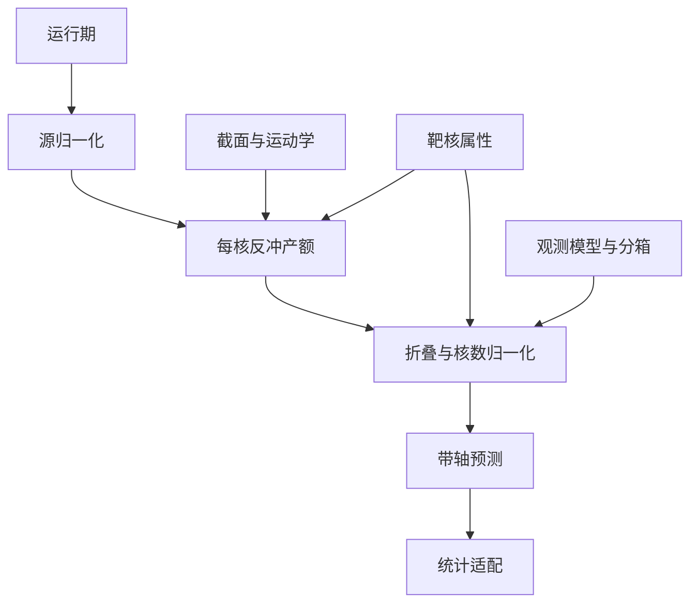

# 架构和明确设计决策

状态：DESIGN。当前证据见 [01](01_BASELINE_AUDIT.md)，具体文件映射见 [07](07_FILE_CHANGE_MAP.md)。

## 1. 设计目标

独立变化的物理职责有稳定边界；人从组装入口可以读懂实验，Skill 从合同和依赖记录可以确定替换范围。
物理依赖允许下游重新计算，但不应迫使无关下游函数反复修改。
模块数量不是目标，一个物理模型可以包含多个内部文件。

## 2. 三层结构

| 层 | 内容 | 依赖原则 |
|---|---|---|
| 合同与物理对象 | 单位、轴、返回对象、能力声明、校验 | 不 import 具体实验 |
| 物理实现与数值执行 | 源、截面、核响应、探测器；积分/折叠/Fast | 依赖合同；数值执行不自行挑选实验 |
| 组装与用户入口 | CsI2021 工厂、配置解析、旧 API 兼容 | 显式选择具体实现 |

`contracts/` 只定义跨边界所需的少量对象和 Protocol，不放公式，不建立万能配置对象。
`ExperimentModel` 是组装结果，不传入每个底层函数。下层只接收自己实际需要的对象。
TheoryPoint、StateParameters、IntegrationSettings 等跨边界参数类型放在中性的 contracts/parameters.py；合同模块不得为了类型注解反向 import core/model.py，避免循环依赖。
`core/engine.py` 当前是兼容 re-export，不要将它扩展成包含所有公式的第二个巨型模块。

## 3. 固定工程决策

### D01：先保留旧物理约定

以 CsI2021 9 箱作为首条纵向闭合链。源插值尾部、质量近似、核响应规范、antinu 约定均记录为 legacy，不在接口迁移时顺手修正。
发现疑似物理问题时登记 [14](14_RISKS_AND_OPEN_INPUTS.md) 的问题清单，分开提出修正。

### D02：外层使用明确的 MeV/keV，理论内部保留现有 GeV

- 源能量：MeV；核反冲：keV；截面：cm²/keV。
- 源积分注量密度：cm^-2 MeV^-1；谱线权重：cm^-2。
- 核运动学质量：GeV；核数换算质量：kg；时间轴注明 clock 与单位。
- 新集成边界固定单位，适配器一次转换。禁止在同一参数中接受未声明的 MeV 或 GeV。

这是为了适配已有 rates 接口。以后统一更多内部单位属于独立、可验证的变更。

### D03：积分器只接收探测器处的运行期积分注量

`SourceModel.for_run(run)` 返回 `DetectorFluence`。原始每秒 flux 与已积分 fluence 是不同输入类型，在此入口归一化。
计数器不接收 `time_factor` 开关来猜测是否要再乘秒数/POT。
模块接口审阅和本轮范围见 [09](09_MODULE_INTERFACE_REVIEW.md)。

### D04：靶核清单交付真实核数

下游使用 `TargetIsotope.number_of_nuclei`，不再读取源对象中的探测器质量或隐含的材料权重。
核素求和是计数求和；核子和 flavor 干涉留在相互作用模型内部。

### D05：主链截面边界返回已与入射态收缩的标量/能量向量

`InteractionModel.dsigma_dT` 是通用 Slow 所需的最小能力。
现有 3×3 flavor kernel 可以作为相互作用模型内部及诊断接口保留；不强制每种相互作用都暴露 EFT 系数多项式。
Fast 编译能力是另一个可选接口，不能从有 `dsigma_dT` 推导出可构建二次系数核。
作用过程固定为当前质量近似下的弹性中微子–核散射；改变末态自由度要升级过程合同。

### D06：探测器概率与数值求积权重分开

`bin_probabilities` 是无量纲概率；不能包含 dT 权重、源强、质量和核数。
实际求积生成的加权矩阵使用另外的对象和单位。兼容旧 PE 插值算法时，数值执行后端负责相同的插值/截断顺序，不能把数值修正伪装成物理概率。

### D07：物理、扫描参数、数值设置分开

`ExperimentModel` 保存组件与运行期；`TheoryPoint` 保存本次理论参数；`IntegrationSettings` 保存网格和算法。
组件实例不可依赖可变模块全局状态。数据数组在边界复制并设为只读，或提供等效的受控不可变机制；`dataclass(frozen=True)` 本身不会冻结数组内容。

### D08：显式组合优先

先使用清楚的 Python 工厂构造模型；将来 YAML 只选择已注册工厂与类型化参数。
禁止任意 YAML 字符串动态 import 未约束对象；拒绝未知配置键。
当前 `read_simple_yaml` 不是完整 YAML 解析器，不可直接把包含复杂对象的设计示例交给它并假定成功。
解析后的 `ResolvedModelRecord` 才是本次运行实际使用的参数记录，避免 YAML 和 Python 各自成为一套参数来源。

### D09：兼容性与物理版本分别记录

`contract_id/contract_version` 表示调用合同；`model_id/model_revision` 表示物理实现。
更换数表可能保持合同版本，但必须更新模型内容指纹。
模块描述从实际实例导出；说明文档、Skill 读取的是同一描述，不维护第二套手写“实际运行配置”。

### D10：渐进迁移，保留原入口

先新增适配器和新主链，测试后再让旧入口委托新实现。旧入口签名和历史输出含义继续受回归保护。
CsI2017/Ar2020 的共享函数在其迁移前保留；新通用代码不通过修改其全局默认达到复用。
后续清理过时函数需要调用者清单，不凭文件名判断没人使用。

## 4. 依赖图

缓存按实际依赖缓存；不要把“某个输入改变”机械解释为所有对象都失效。
例如纯探测器概率在源改变但反冲网格不变时可复用；已积分的事件系数核通常必须重新生成。

## 5. 成功判据

同一进程能构造两个不同源或探测器的模型，两者互不污染；调用同一 `predict`。
一个源实现只需要了解源合同和自身数据，无需修改理论或积分器。
一个模块的接口不兼容时，在昂贵计算前给出具体错误，而不是静默使用默认值。
人读实验工厂就能知道采用的物理组合；读结果能知道数组单位、轴与已施加的归一化。
